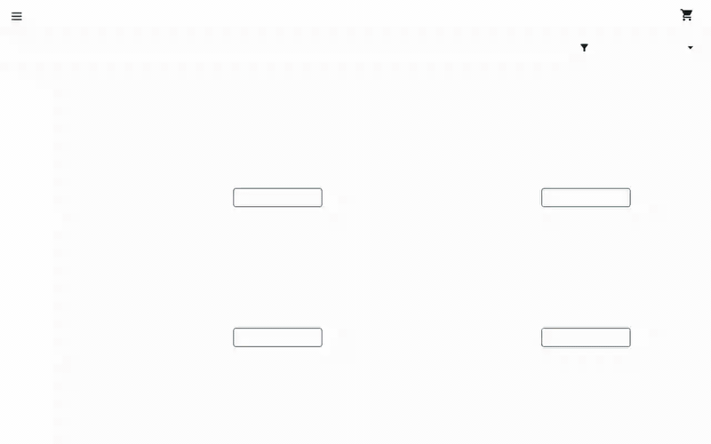
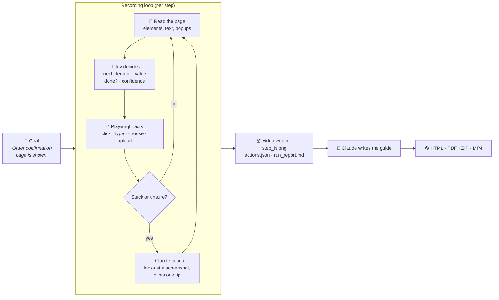
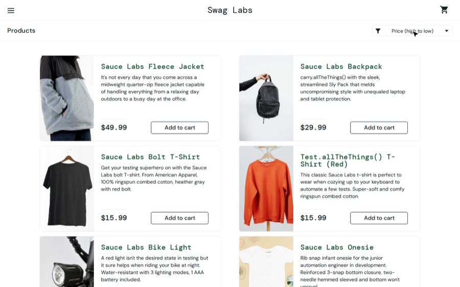
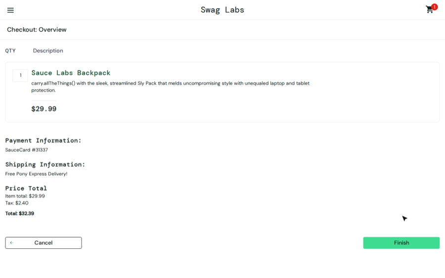
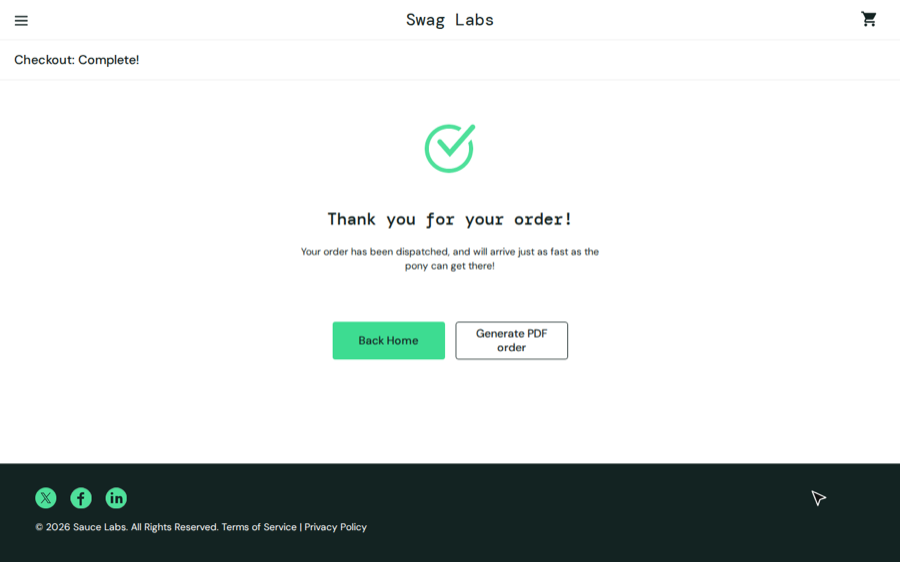

<div align="center">

# 🎬 Jev Docs Agent

### Describe the goal. Get the video, the screenshots and the user guide.

**An open-source, goal-driven agent that walks through any web app in a real browser, records every task as a<br>
walkthrough video, and turns the recordings into polished user documentation — driven from Claude Desktop.**

[](LICENSE)
[](https://www.python.org/)
[](https://playwright.dev/)
[](https://modelcontextprotocol.io/)
[](Dockerfile)
[-111111)](https://typesafe.ai)

[Quick start](#-quick-start) · [Use cases](#-use-cases) · [How it works](#-how-it-works) · [Alternatives](#-how-it-compares) · [Claude Desktop](#-drive-it-from-claude-desktop-mcp) · [FAQ](#-faq)

<br>



<sub>A real recording: the agent was only told <i>"Order confirmation page shows 'Thank you for your order!'"</i> — it planned every click.</sub>

</div>

---

## ✨ Why this exists

Product walkthroughs, help-center articles and test evidence all need the same thing: **someone clicking through the
app, recording it, taking screenshots, and writing it up** — and doing it all again after every UI change.

Jev Docs Agent does that work for you:

```yaml
- name: checkout
  goal: "Order confirmation page shows 'Thank you for your order!'."
```

That's a complete test case. The agent opens a browser, figures out the clicks, records an HD video with a visible
cursor, captures a screenshot after every step, and hands the recording to Claude to write the guide.
When the UI changes, you re-run it — **no selectors to fix, no scripts to maintain.**

<table>
<tr>
<td width="33%" valign="top">

### 🎯 Goal-driven
Say what *finished* looks like. Jev decides each click from the live page — buttons can move, get renamed or
restyled and the goal still works. Hints are optional.

</td>
<td width="33%" valign="top">

### 🎥 Evidence by default
Every run produces a `.webm` video, a screenshot per action, an `actions.json` trail of every decision, and a
pass/fail report.

</td>
<td width="33%" valign="top">

### 📚 Docs, not just videos
Claude turns recordings into how-to guides, quick-starts and FAQs — exported as one HTML page (→ PDF) or a zip with
MP4s.

</td>
</tr>
<tr>
<td valign="top">

### 💬 Runs from a chat
20 MCP tools let Claude Desktop create projects, write goals, record, debug failures and write docs. No YAML needed.

</td>
<td valign="top">

### 🔐 Bring any login
Credentials are supplied, never stored in config: per-project `.env`, role profiles (admin / viewer), or
`docker -e` in CI.

</td>
<td valign="top">

### 💸 Very low cost
Jev answers in typed decisions, not prose. The 5-video example below estimated **~33 Jev calls ≈ $0.01**.

</td>
</tr>
</table>

---

## 🧭 Use cases

| | Use case | What you get |
|---|---|---|
| 📖 | **Help-center & user guides** | Step-by-step articles with real screenshots and a video per task, regenerated in minutes after a release |
| 🚀 | **Customer onboarding** | "Your first 5 minutes" quick-starts and walkthrough videos for new users |
| 🎞️ | **Product demos & interactive tours** | Short, cursor-highlighted demo clips of each feature for sales, landing pages and release notes |
| 🧪 | **Goal-based end-to-end testing** | Natural-language smoke/regression tests with pass/fail, video evidence and a step log — no selectors |
| ✅ | **Manual-test replacement & UAT evidence** | Executes the steps from your manual test cases and records proof for sign-off, audits or QA reports |
| 🔄 | **Docs drift detection** | Re-run after each deploy: a failed or changed video tells you the docs (or the UI) need attention |
| 👥 | **Role & permission walkthroughs** | Same goal, different credential profiles — see exactly what admins vs. viewers can do |
| 🌍 | **Multi-environment checks** | Point one project at staging, then production, with `-e LOGIN_*` per environment |
| 🎓 | **Training & internal enablement** | Recorded procedures for support teams, new hires and SOPs |
| 🧾 | **Compliance & change records** | Timestamped videos + screenshots of how a workflow behaves at each release |
| 🐞 | **Bug reproduction** | Describe the bug's path as a goal; get a video of exactly what happens |
| 🤝 | **Agencies & consultants** | One tool, many client apps — each client is its own project with its own login |

<details>
<summary><b>Who it's for</b></summary>

- **Technical writers / docs teams** — keep screenshots and steps current without re-shooting everything by hand.
- **Product & growth teams** — produce demo clips and onboarding content without a video tool subscription.
- **QA & test engineers** — express tests as goals, get evidence for free, stop maintaining brittle selectors.
- **Founders & small teams** — get a help center and a smoke test suite from the same few lines of YAML.
- **Developers** — script it from the CLI or CI with Docker; everything is plain files.

</details>

---

## 🆚 How it compares

Jev Docs Agent is an **open-source, self-hosted alternative** that sits between demo builders, documentation tools and
test automation — it does a useful part of each, from one goal definition.

| | **Jev Docs Agent** | Demo builders<br><sub>Supademo, Arcade, Storylane, Navattic</sub> | Guide/doc capture<br><sub>Scribe, Tango, Guidde</sub> | Scripted E2E testing<br><sub>Playwright, Cypress, Selenium</sub> | Manual testing |
|---|:---:|:---:|:---:|:---:|:---:|
| Records itself (no human clicking) | ✅ | ❌ | ❌ | ✅ | ❌ |
| Defined by a goal in plain English | ✅ | — | — | ❌ code + selectors | ✅ test steps |
| Survives UI changes without edits | ✅ mostly | ❌ re-record | ❌ re-record | ❌ fix selectors | ✅ |
| Walkthrough video | ✅ webm / mp4 | ✅ | ⚠️ some | ⚠️ on failure | ❌ |
| Written user guide | ✅ AI-written | ⚠️ captions | ✅ | ❌ | ❌ |
| Pass / fail result | ✅ | ❌ | ❌ | ✅ | ✅ |
| Interactive click-through demo | ❌ | ✅ | ❌ | ❌ | ❌ |
| Precise assertions (exact values, API state) | ⚠️ visual goal checks | ❌ | ❌ | ✅ | ✅ |
| Self-hosted, open source, your data stays local | ✅ MIT | ❌ SaaS | ❌ SaaS | ✅ | ✅ |
| Cost | API usage only (cents) | per-seat SaaS | per-seat SaaS | free + engineer time | tester time |

**Use it instead of…**

- **Supademo / Arcade / Storylane** — when you need *videos and written guides* of real flows, regenerated on every
  release, rather than hand-built interactive tours. Keep a demo builder if you need clickable, branching tours with
  lead capture.
- **Scribe / Tango** — when you want the capture done *for* you: nobody has to click through the app.
- **Manual testing** — for repeatable happy-path checks and UAT evidence; keep humans for exploratory testing and
  judgment calls.
- **Playwright / Cypress scripts** — for smoke tests and flows that break often because of UI churn. Keep coded tests
  where you need exact assertions, data setup and millisecond-level reliability in CI. The two work well together: this
  project is built *on* Playwright.

> **Honest limits.** Goal-based checks are judged visually by a model, so they are excellent at "did the flow work?"
> and weaker at "is this number exactly 42.17?". It's not a load-testing or security-testing tool.


---

## ⚙️ How it works



**[Jev](https://typesafe.ai)** is TypeSafe AI's *System One* model: instead of writing prose it returns **typed
decisions with calibrated confidence**. Every step the agent asks Jev several structured questions at once —
*which element next? what to type? did the last action work? is the goal done?* — so it's fast, cheap and knows when
it's unsure. When it is unsure, a **Claude coach** looks at a screenshot and gives one concrete tip. Safety rails sit
around all of it:

- 🚫 **`forbid_labels`** — buttons the agent may never click (payments, delete, sign out) unless a video explicitly allows them.
- 🔒 **Secrets stay secret** — passwords come from env files, are typed into fields but never written to logs, `actions.json` or tool replies.
- ⏱️ **Budgets** — max steps, max wait, stall detection and loop detection on every video.
- ✅ **Honest "done"** — a video only passes after at least one action *and* a confident goal check.

---

## 🚀 Quick start

> **Prereqs:** Docker (or Python 3.12) and an [OpenRouter](https://openrouter.ai) key (or a
> [TypeSafe](https://typesafe.ai) key). The example uses [Sauce Demo](https://www.saucedemo.com), a public test shop.

```bash
git clone https://github.com/kaivalpatel6350/jev-docs-agent.git && cd jev-docs-agent
cp .env.example .env                                    # add OPENROUTER_API_KEY
cp projects/swaglabs/.env.example projects/swaglabs/.env  # Sauce Demo's public test login
```

<table>
<tr><th>🐳 Docker</th><th>🐍 Local Python</th></tr>
<tr><td>

```bash
docker build -t jev-docs-agent .

docker run --rm -v "$PWD/projects:/app/projects" \
  --env-file .env jev-docs-agent \
  python agent.py videos --project swaglabs
```

</td><td>

```bash
python -m venv .venv && source .venv/bin/activate
pip install -r requirements.txt
playwright install chromium

python agent.py videos --project swaglabs
```

</td></tr>
</table>

In about two minutes you'll have five videos and a report in `projects/swaglabs/out/`:

| Video | Goal (all the agent was told) | Result |
|---|---|---|
| `login` | Signed in: the Products page is shown | ✅ 3 actions |
| `sort-products` | Sorted by each option, ending on Price (high to low) | ✅ 3 actions |
| `add-to-cart` | Cart shows the product, then it's removed and the cart is empty | ✅ 4 actions |
| `checkout` | Order confirmation page shows "Thank you for your order!" | ✅ 8 actions |
| `logout` | Signed out through the menu; the login page is shown | ✅ 2 actions |

<p align="center">
  
  
  
</p>

Then write and export the docs — from Claude Desktop (below) or the CLI:

```bash
python agent.py docs   --project swaglabs          # Claude writes the guides (uses your OpenRouter key)
python agent.py export --project swaglabs --mp4    # one HTML guide + a zip with MP4s
```

👉 See a generated result: **[docs/example-swag-labs-guide.md](docs/example-swag-labs-guide.md)**


---

## 💬 Drive it from Claude Desktop (MCP)

The MCP server lets Claude Desktop do everything — including writing `guides.yaml` for a brand-new app.

**1. Build the image**, then **2.** merge this into `~/Library/Application Support/Claude/claude_desktop_config.json`
(Windows: `%APPDATA%\Claude\claude_desktop_config.json`) and restart Claude Desktop:

```json
{
  "mcpServers": {
    "docs-agent": {
      "command": "docker",
      "args": ["run", "-i", "--rm",
               "-v", "/ABSOLUTE/PATH/TO/jev-docs-agent/projects:/app/projects",
               "--env-file", "/ABSOLUTE/PATH/TO/jev-docs-agent/.env",
               "-e", "HOST_PROJECTS_DIR=/ABSOLUTE/PATH/TO/jev-docs-agent/projects",
               "jev-docs-agent"]
    }
  }
}
```

**3. Just ask:**

> *"Create a docs project for https://app.acme.com. Make videos for signing in, creating an invoice and exporting a
> report. Record them, fix anything that fails, then write a how-to guide and export it as HTML and MP4."*

> *"Here's our user manual (attached) — make a video for every how-to in it and group them into guides."*

> *"Record the settings videos as the admin profile, then compare with the viewer profile."*

<details>
<summary><b>All 20 tools</b></summary>

| Area | Tools |
|---|---|
| Projects | `list_projects` · `create_project` · `get_project` · `update_settings` · `check_project` |
| Test logins | `get_credentials` · `set_credentials` · `remove_credentials_profile` |
| Goals | `add_video` · `remove_video` |
| Recording | `run_videos` (background job) · `job_status` · `stop_job` · `get_recording` (steps, screenshots, why it failed) |
| Docs | `add_doc` · `remove_doc` · `get_doc_brief` · `save_doc` · `get_doc` |
| Sharing | `export_project` (HTML guide · ZIP · MP4) |

When Claude Desktop writes the docs itself (`get_doc_brief` → `save_doc`), no Claude API key is needed — only Jev's key
is used for recording. Every edit to `guides.yaml` keeps a `.bak`.

</details>

---

## 📝 Writing goals

```yaml
app_url: https://www.saucedemo.com
forbid_labels: [Logout, Reset App State, Delete Account, Purchase]
test_data:
  username: ${LOGIN_USERNAME}        # secret → supplied from .env / docker -e
  password: ${LOGIN_PASSWORD}
  first_name: Jane                   # plain demo values Jev may type

videos:
  - name: login
    goal: "Signed in: the Products page (inventory list) is shown."
    start_path: /

  - name: checkout
    goal: "Order confirmation page shows 'Thank you for your order!'."
    start_after: login               # reuse the signed-in session
    start_path: /inventory.html
    hints:                           # optional — only where Jev needs help
      - "Fill First Name, Last Name, Zip/Postal Code from test data"

docs:
  - name: shopping-guide
    type: how-to guide
    audience: new customers
    videos: [login, checkout]
```

| Key | What it does |
|---|---|
| `goal` | What *finished* looks like, checkable on screen. One task per video. |
| `hints` | Optional steps. `**Label**` = exact button text, `'text'` = which row/section. |
| `start_after` / `start_path` | Reuse a previous video's session; open a specific page. |
| `allow` | `forbid_labels` this one video may click (e.g. `Logout` for a logout video). |
| `enabled: false` + `reason` | Never recorded (payments, real emails) — documented from your reference doc. |
| `reference_doc` | An existing manual (`.docx` / `.md`) whose wording and button names the docs should keep. |

**Tips:** make goals verifiable (*"the list shows INV-001 as Sent"* beats *"create an invoice"*), keep one task per
video, use demo accounts and synthetic data — screenshots are sent to the model.

---

## 🔐 Test logins

`guides.yaml` only names variables; values are supplied separately, so one project runs against any account or
environment. Precedence: **`docker -e` / shell → `.env.<profile>` → project `.env` → root `.env`**.

| How | Where | Best for |
|---|---|---|
| *"Set the login for acme: qa@acme.com / …"* | `projects/acme/.env` | quick setup with demo accounts |
| Edit the file yourself | `projects/acme/.env` | real test accounts (never passes through chat) |
| *"Add an admin login"* | `projects/acme/.env.admin` (only what differs) | role-based walkthroughs |
| `docker run -e LOGIN_USERNAME=… -e LOGIN_PASSWORD=…` | process env | CI and other environments |

Pick per run: `run_videos(profile="admin")`, `--profile admin`, or `-e LOGIN_PROFILE=admin`.

---

## 🧰 CLI reference

```bash
python agent.py plan    --project <name>                  # free: validate config, credentials, run order, cost
python agent.py videos  --project <name> [--only a,b] [--profile admin]
python agent.py docs    --project <name> [--only a] [--dry]   # Claude writes docs (--dry: build requests only)
python agent.py improve --project <name> [--only a]       # Claude rewrites failed goals/hints and re-records
python agent.py export  --project <name> [--only a] [--mp4]
```

<details>
<summary><b>Project layout</b></summary>

```
agent.py              recording loop (Jev + Playwright), docs, improve, export CLI
mcp_server.py         20 MCP tools for Claude Desktop
exporter.py           HTML guide / ZIP / MP4 packaging
projects/<name>/
  guides.yaml         app_url, test_data, forbid_labels, videos (goals), docs
  .env, .env.<role>   test logins (git-ignored)
  out/                videos/<video>/{video.webm, step_N.png, actions.json}, docs/, exports/, run_report.md
```

</details>


---

## ❓ FAQ

<details>
<summary><b>What is Jev?</b></summary>

[Jev](https://typesafe.ai) is TypeSafe AI's first public *System One* model — built for decisions inside software rather
than chat. You send it structured questions (`Choice`, `Noul`, `Score`) and get typed answers with calibrated
confidence. That makes it a good fit for a browser agent that needs to pick one element out of hundreds, many times
per video, cheaply. It's available through the TypeSafe API and OpenRouter.
</details>

<details>
<summary><b>Do I need Claude?</b></summary>

Recording only needs Jev. Claude is used for the optional *coach* (when Jev is stuck), for `improve`, and for writing
docs from the CLI. If you use Claude Desktop, it writes the docs itself through MCP. One OpenRouter key covers Jev and
Claude.
</details>

<details>
<summary><b>What does it cost?</b></summary>

`python agent.py plan` estimates it before you run anything. The Sauce Demo example estimated ~33 Jev calls
(≈ $0.01). Coach calls and doc writing with Claude cost more than Jev calls; with Claude Desktop writing the docs they
come out of your Claude plan.
</details>

<details>
<summary><b>Does it work with any web app? What about SSO, MFA or CAPTCHAs?</b></summary>

Any app a browser can open. Username/password logins work out of the box; the session is reused across videos.
SSO redirects usually work if the test account doesn't need MFA. MFA codes and CAPTCHAs are not solved — use a test
account without them, or a test environment that disables them.
</details>

<details>
<summary><b>Is my data safe?</b></summary>

Everything runs on your machine or your own Docker host; outputs are plain files. Page text and screenshots are sent
to the model providers you configure (TypeSafe / OpenRouter / Anthropic), so use demo accounts and synthetic data.
Passwords are never written to logs, `actions.json` or MCP replies — but if your app *prints* a secret on screen, it
will appear in screenshots.
</details>

<details>
<summary><b>Why webm videos?</b></summary>

That's what Playwright records. `export --mp4` (or *"export as mp4"*) converts them to H.264 MP4 for PowerPoint,
Confluence, Notion or any player.
</details>

<details>
<summary><b>Can I run it in CI?</b></summary>

Yes — `docker run … python agent.py videos --project <name>` exits after writing `run_report.md` and `actions.json`
per video, with credentials from `-e` variables. Fail the build by checking each video's `status`.
</details>

---

## 🗺️ Roadmap

- [ ] Login-free continuation: record one session and cut per-task clips
- [ ] GitHub Action + JUnit report for CI
- [ ] Narrated videos (text-to-speech over each step)
- [ ] Auto-detect UI changes between runs and flag outdated docs
- [ ] More export targets (Confluence, Notion, Docusaurus)

Ideas and PRs welcome — open an issue to discuss.

## 🤝 Contributing

1. Fork and create a branch.
2. Add a project under `projects/` against a public demo app to reproduce your change.
3. Run `python agent.py plan --project <name>` and a recording, then open a PR with the result.

Please never commit `.env` files, real credentials or recordings of private apps.

## 📄 License

[MIT](LICENSE) © 2026 Kaival Patel. Jev and TypeSafe are trademarks of TypeSafe AI; Claude is a trademark of Anthropic;
Supademo, Arcade, Storylane, Navattic, Scribe, Tango and Guidde are trademarks of their respective owners and are
mentioned only for comparison. This project is not affiliated with any of them. Sauce Demo is a public demo site by
Sauce Labs.

<div align="center">
<br>

**If this saves you a day of screenshots, give it a ⭐**

<sub>`jev` · `typesafe-ai` · `system-one` · `ai-agent` · `browser-automation` · `playwright` · `mcp` · `claude-desktop` · `documentation-generator` · `walkthrough-videos` · `e2e-testing` · `no-code-testing` · `supademo-alternative` · `scribe-alternative` · `test-automation` · `open-source`</sub>

</div>

