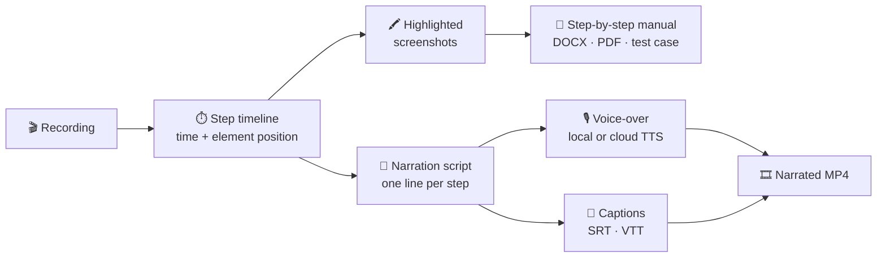

# 🗺️ Roadmap

> Where Jev Docs Agent is going next. Everything here is open for discussion — **💡 [share an idea](https://github.com/kaivalpatel6350/jev-docs-agent/discussions/categories/ideas)**,
> 👍 the issues you care about, or pick one up (see [CONTRIBUTING.md](CONTRIBUTING.md)).

**Legend** · Status: 🟢 shipped · 🟡 in progress · ⚪ planned · 💭 exploring · Effort: **S** ≈ a day · **M** ≈ a few days · **L** ≈ a week+

---

## ✅ Shipped — v0.1

- Goal-driven recording (Jev decisions + Playwright) with a Claude coach when the agent is stuck
- Walkthrough video, screenshot per step, `actions.json` trail and pass/fail report
- AI-written docs (how-to guides, quick-starts, FAQs) and `improve` to repair failed goals
- MCP server — 20 tools so Claude Desktop runs everything
- Supplyable test logins: per-project `.env`, role profiles, `docker -e` overrides
- Export: one-page HTML guide (→ PDF), ZIP with media, optional MP4
- Docker image; Sauce Demo example project

---

## 🎙️ v0.2 — Narrated & annotated

The theme: turn each recording into **content you can publish as-is** — narrated videos and printable manuals.



| # | Feature | Status | Effort | Why |
|---|---|:---:|:---:|---|
| 1 | **Step timeline** — record each step's video timestamp and the clicked element's position in `actions.json` | ⚪ | S | Foundation for voice-over sync, highlights, captions and tours |
| 2 | **Highlighted screenshots** — numbered box/arrow on the clicked element (drawn after recording; video stays clean) | ⚪ | S | Manuals and guides readers can follow at a glance |
| 3 | **Step-by-step manual** — numbered steps with highlighted screenshots and expected results, exported to **DOCX and PDF**; plus a **QA test-case** format (Steps / Expected / Actual / Evidence) | ⚪ | M | Replaces hand-written SOPs, training manuals and manual test cases |
| 4 | **Captions** — SRT/VTT from the narration script, optional burned-in subtitles | ⚪ | S | Accessibility; videos that work muted |
| 5 | **AI voice-over** — Claude writes one spoken line per step; pluggable TTS: free local voice (default, offline) or cloud voices (OpenAI, ElevenLabs); audio synced per step, frames held so speech never cuts off | ⚪ | M–L | Publish-ready narrated walkthroughs |

<details>
<summary><b>Proposed design: voice-over</b></summary>

```yaml
settings:
  narration:
    provider: local          # local (default, offline) | openai | elevenlabs
    voice: en-US-1
    language: en             # translate script + captions
    captions: burn           # none | file | burn

videos:
  - name: checkout
    goal: "Order confirmation page shows 'Thank you for your order!'."
    script:                  # optional — edit any generated line; kept on re-runs
      4: "Click Checkout to review your order."
```

- `python agent.py narrate --project x [--only checkout]` · Claude Desktop: *"narrate the checkout video in French"*
- Output: `video_narrated.mp4`, `captions.srt`, `captions.vtt`, `script.json` next to `video.webm`
- Audio per step is placed at the step's timestamp; if a line is longer than the step, the last frame is held
- Secrets are never spoken (typed values from `.env` are named, e.g. "enter your password")
</details>

<details>
<summary><b>Proposed design: step-by-step manual</b></summary>

```yaml
docs:
  - name: checkout-manual
    type: manual             # manual | test-case | how-to guide | quick-start | faq
    audience: new customers
    videos: [login, checkout]
```

- Structure: title → purpose → prerequisites → numbered steps (action · highlighted screenshot · expected result) → troubleshooting
- `python agent.py export --project x --manual` → `.docx` (python-docx, already a dependency) and `.pdf` (rendered by the bundled Chromium — no new dependency)
- `type: test-case` → Steps / Expected / Actual (✅/❌ from the run) / Evidence (screenshot + video link)
</details>

---

## 🚀 v0.3 — Share & verify

| # | Feature | Status | Effort | Why |
|---|---|:---:|:---:|---|
| 6 | **Interactive HTML tour** — self-hosted click-through built from step screenshots and click positions | ⚪ | M | Open-source, lightweight take on interactive demos; closes the biggest gap vs. demo platforms |
| 7 | **Trim login & idle time** — cut repeated sign-ins and long waits out of clips | ⚪ | M | Shorter, cleaner videos |
| 8 | **CI integration** — GitHub Action + JUnit XML report | ⚪ | M | Run goals on every PR/deploy; fail builds on broken flows |
| 9 | **Visual change detection** — compare screenshots between runs, flag outdated docs and demos | ⚪ | M | Docs drift alerts after each release |
| 10 | **Multi-language** — docs, captions and voice in several languages from one recording | ⚪ | M | Localised help centers |

---

## 🔭 Later

| Feature | Notes |
|---|---|
| Export to **Confluence, Notion, Docusaurus/MkDocs, GitBook, Zendesk** | Publish straight into your help center |
| **Explore mode** | Agent browses the app and proposes goals to record |
| **Import test cases** | Turn CSV, Gherkin or TestRail cases into goals |
| **TOTP / MFA** for test accounts | Use a supplied TOTP secret for 2FA logins |
| **Mobile & responsive** | Record at phone and tablet viewports |
| **Persistent server mode** | HTTP MCP transport so runs survive closing Claude Desktop |
| **Branding** | Intro/outro cards, logo watermark, theme colors |
| **Zoom & pan** | Zoom into each click for small UI elements |

## 💭 Exploring — tell us if you want these

- Web dashboard to browse runs, videos and docs
- Scheduled runs with Slack / Teams alerts when a flow breaks
- Release notes drafted from what changed between two runs

---

## 💡 How to propose something

1. Search [issues](https://github.com/kaivalpatel6350/jev-docs-agent/issues) and [ideas](https://github.com/kaivalpatel6350/jev-docs-agent/discussions/categories/ideas) — 👍 an existing one if it fits.
2. Otherwise start a **💡 Ideas** discussion: the problem, who has it, and what "done" would look like.
3. Once an idea has a clear shape it becomes a **feature request** issue with the `roadmap` label.

Priorities follow demand — the most 👍 items move up.

