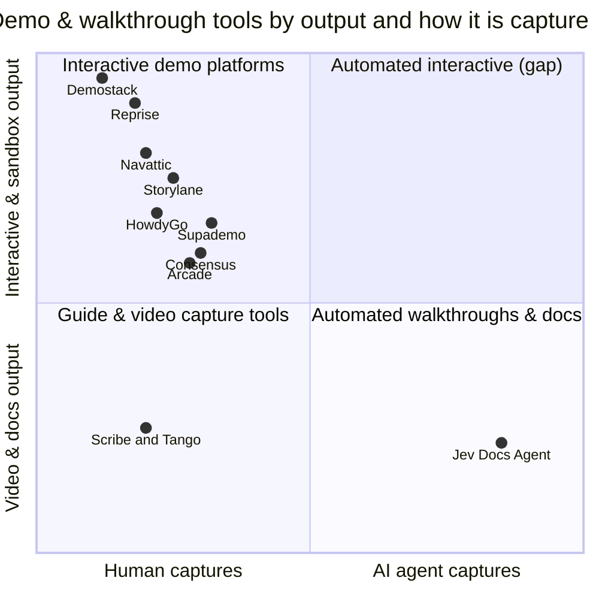
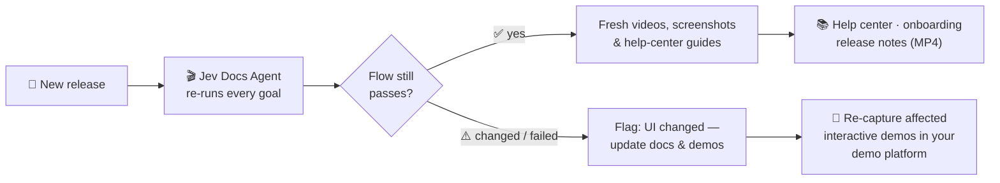

# Jev Docs Agent vs. interactive demo platforms

> Storylane, Navattic, Supademo, Arcade, HowdyGo, Consensus, Reprise, Demostack — where an open-source,
> goal-driven recorder is a real alternative, where it's a complement, and where it isn't a fit.

[← Back to README](../README.md)

---

## TL;DR

Interactive demo platforms and Jev Docs Agent start from the same need — *show people how the product works* — but
solve different halves of it:

| | Interactive demo platforms | **Jev Docs Agent** |
|---|---|---|
| **Who captures the product** | A person clicks through the app while the tool records | **An AI agent** clicks through the app by itself from a plain-English goal |
| **What you get** | An interactive tour, HTML replica or sandbox that buyers click through | **Walkthrough videos, step screenshots, written guides** and a pass/fail result |
| **After a UI change** | Someone re-captures and re-edits the demo | **Re-run the same goal** — new videos, screenshots and docs in minutes |
| **Built for** | Marketing, PLG and sales teams engaging buyers | Docs, onboarding, support, product and QA teams documenting real flows |
| **Delivery** | SaaS, per-seat subscription, hosted embeds, analytics, CRM sync | Open source (MIT), self-hosted, plain files, pay only for model API usage |

**In one line:** demo platforms are *presentation* tools; Jev Docs Agent is a *production* tool. It automates the part
humans find tedious — capturing every flow, again after every release — and turns it into videos and documentation.

<table>
<tr>
<td width="33%" valign="top">

### ✅ Use it as an alternative
- Feature walkthrough **videos** for help articles, release notes, changelogs and social posts
- **Step-by-step guides** with fresh screenshots
- Onboarding and training **video libraries**
- Keeping all of the above **current on every release**

</td>
<td width="33%" valign="top">

### 🤝 Use it alongside
- **Interactive tours** on your homepage → keep Arcade / Supademo / Storylane
- **Buyer analytics & ABM** → keep Navattic / Storylane
- Use the agent to capture every flow fast and to tell you **which demos went stale** after a release

</td>
<td width="33%" valign="top">

### ❌ Not a fit
- Clickable, branching, **interactive** demos
- **Sandbox / cloned** environments for live sales calls
- Lead capture forms, buyer intent, **CRM / ABM** tracking
- Personalised demos per prospect

</td>
</tr>
</table>

---

## The demo-platform landscape, and where this project fits

Positions are approximate and only illustrate the two axes; several platforms now add AI captions, voiceovers or
assistants on top of human-captured demos.

| Category | Platforms | Primary strength |
|---|---|---|
| **High-fidelity & full-funnel builders** | Storylane · Navattic · Supademo | Screenshot or HTML capture, guided tours, marketing analytics and integrations |
| **Lightweight & fast product tours** | Arcade · HowdyGo | Quick, polished click-through tours to embed on sites and help articles |
| **Enterprise & sales-engineering platforms** | Consensus · Reprise · Demostack | Personalised async demos, cloned/sandboxed apps for deep technical evaluation |
| **Automated walkthroughs & docs** | **Jev Docs Agent** | AI agent records real flows from goals → videos, guides, pass/fail; re-run on every release |

---

## Feature comparison

✅ = core strength · ⚠️ = partial / via add-ons · ❌ = not offered. Based on public product information as of 2026;
these products change quickly — check each vendor for current features.

| | **Jev Docs Agent** | Storylane | Navattic | Supademo | Arcade | HowdyGo | Consensus | Reprise | Demostack |
|---|:---:|:---:|:---:|:---:|:---:|:---:|:---:|:---:|:---:|
| **Capture** | | | | | | | | | |
| AI agent captures flows by itself | ✅ | ❌ | ❌ | ❌ | ❌ | ❌ | ❌ | ❌ | ❌ |
| Defined by a plain-English goal | ✅ | ❌ | ❌ | ❌ | ❌ | ❌ | ❌ | ❌ | ❌ |
| Re-capture after UI changes without editing | ✅ | ❌ | ❌ | ❌ | ❌ | ❌ | ❌ | ❌ | ❌ |
| Screenshot capture | ✅ | ✅ | ✅ | ✅ | ✅ | ✅ | ⚠️ | ✅ | ❌ |
| HTML capture / interactive replica | ❌ | ✅ | ✅ | ⚠️ | ⚠️ | ✅ | ⚠️ | ✅ | ✅ |
| App cloning / sandbox with live data | ❌ | ⚠️ | ❌ | ❌ | ❌ | ❌ | ❌ | ✅ | ✅ |
| **Output** | | | | | | | | | |
| Walkthrough video (webm / mp4) | ✅ | ✅ | ⚠️ | ✅ | ✅ | ⚠️ | ✅ | ⚠️ | ❌ |
| Written step-by-step guide | ✅ | ⚠️ | ❌ | ⚠️ | ⚠️ | ❌ | ❌ | ❌ | ❌ |
| One-page HTML / PDF / ZIP export | ✅ | ⚠️ | ❌ | ⚠️ | ⚠️ | ❌ | ❌ | ❌ | ❌ |
| Interactive click-through tour | ❌ | ✅ | ✅ | ✅ | ✅ | ✅ | ✅ | ✅ | ✅ |
| AI captions / voiceover | ⚠️ AI-written text | ✅ | ⚠️ | ✅ | ✅ | ⚠️ | ⚠️ | ⚠️ | ❌ |
| Pass / fail check that the flow still works | ✅ | ❌ | ❌ | ❌ | ❌ | ❌ | ❌ | ❌ | ❌ |
| **Go-to-market** | | | | | | | | | |
| Hosted embeds & share links | ❌ files only | ✅ | ✅ | ✅ | ✅ | ✅ | ✅ | ✅ | ✅ |
| Lead capture & viewer analytics | ❌ | ✅ | ✅ | ✅ | ✅ | ✅ | ✅ | ✅ | ✅ |
| CRM / ABM integrations | ❌ | ✅ | ✅ | ⚠️ | ⚠️ | ✅ | ✅ | ✅ | ✅ |
| Personalised demos per prospect | ❌ | ✅ | ✅ | ⚠️ | ⚠️ | ⚠️ | ✅ | ✅ | ✅ |
| **Ownership** | | | | | | | | | |
| Open source | ✅ MIT | ❌ | ❌ | ❌ | ❌ | ❌ | ❌ | ❌ | ❌ |
| Self-hosted, files stay on your machine | ✅ | ❌ | ❌ | ❌ | ❌ | ❌ | ❌ | ❌ | ❌ |
| Driven from Claude Desktop (MCP) | ✅ | ❌ | ❌ | ❌ | ❌ | ❌ | ❌ | ❌ | ❌ |
| Pricing model | API usage (cents/run) | SaaS tiers | SaaS tiers | SaaS tiers | SaaS tiers | SaaS tiers | Enterprise | Enterprise | Enterprise |

---

## Platform by platform

<b>Storylane</b> — high-fidelity & full-funnel

**Known for:** screenshot *and* HTML capture, step-by-step tours and sandbox-lite experiences, AI captions and
voiceovers, a buyer hub / digital sales room. Strong in PLG and marketing.

- **Choose Storylane** for interactive tours on landing pages, sales rooms and buyer engagement analytics.
- **Choose Jev Docs Agent** when the deliverable is *documentation*: help-center videos and written guides for every
  feature, regenerated automatically after each release.
- **Together:** let the agent capture and verify every flow; publish the hero flows as Storylane tours.

<b>Navattic</b> — marketing-led & ABM

**Known for:** pixel-perfect HTML captures that keep states and animations, plus deep integrations (HubSpot, 6sense,
Demandbase) to see how target accounts engage.

- **Choose Navattic** for account-based marketing and demo engagement data in your GTM stack.
- **Choose Jev Docs Agent** for the post-sale side: onboarding, support articles and training material.
- **Together:** run the agent after each deploy as an early warning that a captured flow has changed.

<b>Supademo</b> — fast, accessible, AI demo agents

**Known for:** ease of use, quick time-to-build, accessible pricing, and AI demo agents that guide viewers through a
pre-built demo and answer questions.

- **The key difference:** Supademo's AI works *on top of a demo a person captured*; Jev Docs Agent's AI does the
  *capturing itself*, in your real app, from a goal.
- **Choose Supademo** for interactive, self-serve demos with an assistant for viewers.
- **Choose Jev Docs Agent** for an open-source, zero-seat way to produce walkthrough videos and guides at scale.

<b>Arcade</b> — lightweight & fastest tours

**Known for:** turning quick screen recordings into polished interactive click-throughs for homepages, feature
announcements and help articles.

- **Choose Arcade** for a single polished interactive tour in minutes.
- **Choose Jev Docs Agent** when you need *dozens* of walkthroughs kept current without anyone re-recording them —
  the agent produces the video (`export --mp4`) for the same help articles and announcements.

<b>HowdyGo</b> — HTML demos at entry-level pricing

**Known for:** full HTML-based demo capture with analytics and CRM sync, priced for early-stage and scaling teams.

- **Choose HowdyGo** for affordable interactive HTML demos with lead and CRM features.
- **Choose Jev Docs Agent** when budget matters most and the goal is documentation and video, not interactive demos —
  it's free software that runs on your own machine.

<b>Consensus</b> — presales demo automation

**Known for:** automated video and interactive demo delivery to multi-stakeholder B2B buying committees, with buyer
intent discovery.

- **Choose Consensus** for personalised, async presales demos and buying-committee insight.
- **Choose Jev Docs Agent** to *produce* the underlying feature videos automatically; it doesn't distribute them or
  track viewers.

<b>Reprise</b> — capture + live app cloning

**Known for:** front-end capture plus live application cloning for isolated, stable sandbox environments used in deep
technical evaluations.

- **Choose Reprise** for sandboxes that prospects or sales engineers can freely explore.
- **Jev Docs Agent is not a sandbox tool.** It records your real app (or a staging copy) and outputs files.

<b>Demostack</b> — cloned front-end with data control

**Known for:** cloning your app's front-end code to build live-demo replicas, with back-end data control to change
charts or names during live pitches without touching production.

- **Choose Demostack** for live sales demos with controllable data.
- **Jev Docs Agent pairs well with a demo environment:** point `app_url` at your demo or staging instance and record
  walkthroughs with clean demo data.

---

## Better together: a release workflow

1. **Every release:** run `python agent.py videos` (or ask Claude Desktop). Passing flows refresh their videos and
   guides automatically.
2. **Failed or changed flows** show exactly which feature moved — that's your list of interactive demos to re-capture.
3. **Publish:** help-center and onboarding content from the agent; interactive hero tours from your demo platform.

---

## Decision guide

| If you need… | Pick |
|---|---|
| Walkthrough videos + written guides for many features, kept current | **Jev Docs Agent** |
| Proof that key flows still work after each deploy (with video) | **Jev Docs Agent** |
| Free / self-hosted, no per-seat pricing, data stays local | **Jev Docs Agent** |
| An interactive tour embedded on your homepage | Arcade · Supademo · Storylane |
| Demo engagement analytics, lead capture, ABM | Navattic · Storylane · HowdyGo |
| Personalised async demos for buying committees | Consensus |
| Sandboxes or cloned apps for deep technical evaluation | Reprise · Demostack |

---

Storylane, Navattic, Supademo, Arcade, HowdyGo, Consensus, Reprise and Demostack are trademarks of their respective
owners. They are mentioned for comparison only; this project is not affiliated with or endorsed by any of them.
Feature information is based on publicly available product descriptions and may be out of date — corrections are
welcome via pull request.

