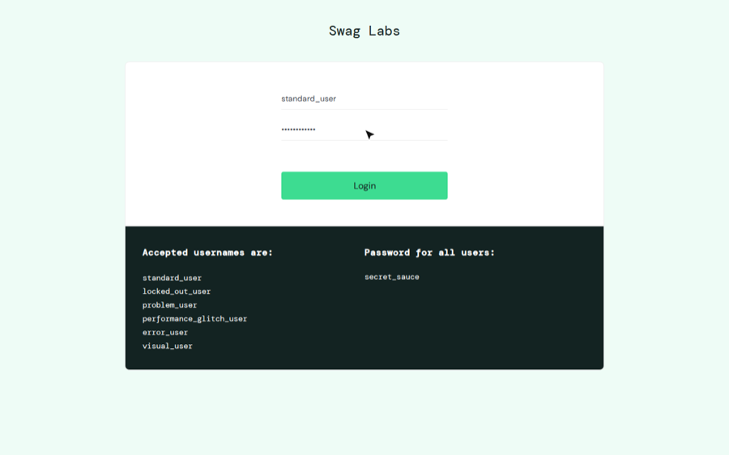
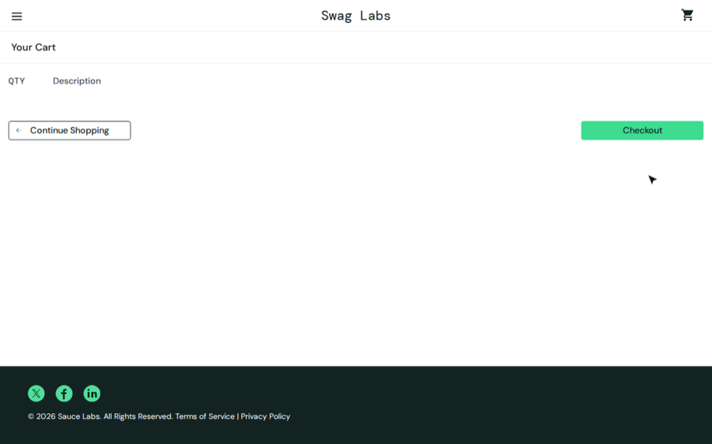
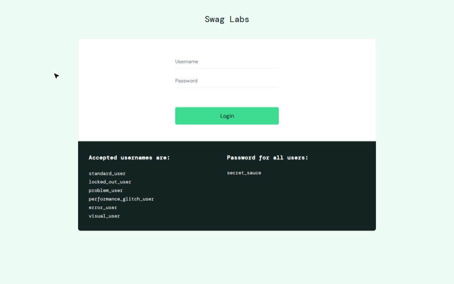

# Swag Labs: Core Features

> **Generated example.** This guide was written by Claude Desktop from five videos the agent recorded on [Sauce Demo](https://www.saucedemo.com) (a public test shop). In a real project each section also links its walkthrough video (`[▶ Watch](../videos/<video>/video.webm)`); videos are not committed to this repo.

## 1. Log in

1. Enter your **Username** and **Password**.
2. Click **Login**. The Products page opens.

## 2. Sort products

1. On **Products**, open the sort dropdown (top right).
2. Choose **Name (A to Z)**, **Name (Z to A)**, **Price (low to high)** or **Price (high to low)**.

## 3. Add to cart

1. Click **Add to cart** on a product. The cart badge shows the count.
2. Click the cart icon to review items.
3. Click **Remove** to take an item out.

## 4. Checkout

1. Add a product, open the cart and click **Checkout**.
2. Enter **First Name**, **Last Name** and **Zip/Postal Code**.
3. Click **Continue**, review the overview, then click **Finish**.
4. You'll see "Thank you for your order!"

## 5. Log out

1. Click the menu (☰) at top left.
2. Click **Logout**. You return to the login page.

